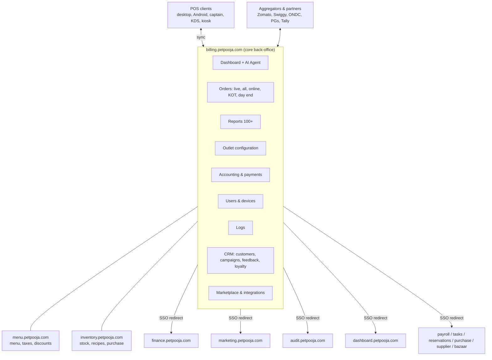

# Petpooja — product overview

**Status:** reviewed
**Last verified:** 2026-11-19
**Source:** authenticated browser observation (demo outlet) + server HTML parse

## Product summary

Petpooja is an India-first restaurant management platform. `billing.petpooja.com` is its **cloud back-office**: owners and managers configure menus, taxes, staff, devices and integrations there, and they monitor orders, reports, payments and logs. Billing itself happens in **POS clients** (Windows/Mac/Linux desktop, Android, captain/waiter apps). These work offline and sync to the cloud.

| Item | Value |
| --- | --- |
| Back-office | `https://billing.petpooja.com` (landing `/users/dashboard/`) |
| Legal entity | Prayosha Food Services Pvt. Ltd. |
| Tenancy | Organization (head office) → brands → outlets (`restaurant_id`) |
| Markets | India primary (GST, FSSAI, UPI, e-invoice); ~56 currencies and timezones supported |

## Product map

## Sub-app domains

| Domain | Entry | Session |
| --- | --- | --- |
| `menu.petpooja.com` | Sidebar › Menu | Shared session, same layout shell |
| `inventory.petpooja.com` | Sidebar › Inventory | Shared session, same layout shell |
| `finance.petpooja.com` | `/users/finance_redirect` | Token handoff → separate SPA session |
| `marketing.petpooja.com` | `/users/marketing_redirect` | Token handoff |
| `audit.petpooja.com` | `/users/logs_redirect` | Token handoff |
| `dashboard.petpooja.com` | `/users/ai_report_redirect` | Separate login observed |
| `payroll.`, `tasksdashboard.`, `reservations.`, `purchase.`, `supplier.`, `bazaar.` | Explore Products / switcher | Not opened |

## Technology observations (Petpooja, for context only)

- Server-rendered PHP app with CakePHP-style routes (`/controller/action/param`) and form fields named `data[Model][field]`.
- jQuery + Bootstrap 5 UI. Lists are AJAX-paged grids. Modals use fancybox popups. Charts use Highcharts.
- Finance and Audit are newer SPAs.
- Inline scripts reveal about 300 AJAX endpoints. See [api-endpoint-inventory](./reference/api-endpoint-inventory.md).
- POS sync is configurable: batch size 2–80, intervals 5–120 min, pending-order sync. Terminals pair via sync and mapping codes.

These are observations, not recommendations. See [implementation-roadmap](./dev/implementation-roadmap.md) for the REA-POS target architecture.

## Audiences

- **Full clone (same UI + features):** start with [`../petpooja-clone/`](../petpooja-clone/).
- Domain / API engineers: [subagent-task-briefs](./dev/subagent-task-briefs.md) and this pack’s modules.
- Product and QA: [FEATURES-EXPLAINED](./FEATURES-EXPLAINED.md).

## Scope

**Captured:** every sidebar item of the billing back-office; the menu and inventory sub-apps; Finance; Audit Trail landing; Marketplace; Marketing Automation landing; the AI Agent prompts.

**Not captured** (also listed in [`../petpooja-clone/04-GAP-CAPTURE.md`](../petpooja-clone/04-GAP-CAPTURE.md)):
- The POS billing screen itself; only its settings were seen.
- The internals of Tasks, TRM, Purchase, Bazaar, Dynamic Dashboard, Google Business, and Marketing Automation.
- Populated grids, because the demo had no sales.
- Some on-demand add/edit popups.

## Relationship to REA in this workspace

`rea/` is a reverse-engineering toolkit (browser scenarios, HAR → agent environments, JS route inventory). This pack was produced with the Cursor browser plus same-origin HTML parsing. REA can extend it with HAR-based endpoint and schema capture. See [AGENTS.md](./AGENTS.md#rea-integration).