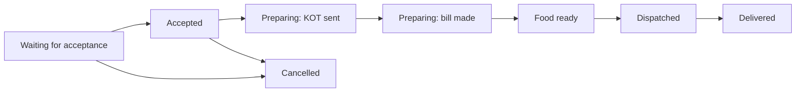

# Every Petpooja feature, explained in plain language

This is the "what does it do and why would a restaurant care" companion to the technical docs. Each section links to the detailed spec for developers. Everything here was observed in the live back-office on 2026-11-19 (demo outlet, no real sales), unless it is marked *not opened*.

**Cloning the product (same features + same UI):** use [`../petpooja-clone/`](../petpooja-clone/) as the build charter. This file explains the product; it does not replace the clone inventory or UI fidelity rules.

## The big picture

Petpooja is two things working together:

1. **The POS (point of sale)** runs on a counter PC, Android device or tablet inside the restaurant. Cashiers take orders, send them to the kitchen and print bills. It keeps working when the internet is down and syncs later.
2. **The back-office website** (`billing.petpooja.com`) is where the owner or manager sets everything up and watches the business. That includes the menu, prices, taxes, staff, printers, online-ordering partners and reports.

Around these sit many add-on apps: the waiter app, kitchen screen, inventory, marketing, finance, payroll and others. Many are paid extras that you switch on from the Marketplace.

---

## 1. Login and account security

*Spec: [01-authentication](./01-authentication.md)*

- **Sign in** with your email or mobile number and a password.
- **Two-factor login (2FA):** an optional extra code at login, switched on from Edit Profile.
- **Change password** and **Logout** are in the profile menu.
- **Extra checks for risky actions:**
  - Permanently deleting a bill, deleting day-end data, or wiping all wallet balances sends a one-time code (OTP) that is valid for 10 minutes.
  - Generating a device pairing code or revealing customer phone numbers asks for your password again.

## 2. The screen around every page

*Spec: [02-dashboard › Global shell](./02-dashboard.md#global-shell-present-on-every-billing-page)*

- **Outlet switcher:** choose which restaurant or brand you are looking at (chains have many).
- **Notifications bell:** alerts from Petpooja and your devices.
- **Product switcher and Explore Products:** jump to the other Petpooja apps (Menu, Inventory, Reports, Bazaar, Finance, and so on) or discover ones you haven't bought.
- **AI Agent:** a chat assistant. You can ask things like "What were my top-selling items yesterday?" or "Generate a graph for next week's sales", or ask how to use the product.
- **Quick Links:** pin the pages you use most to the sidebar.
- **Need Help:** request a call-back, WhatsApp support, or email/phone support.
- **Map Device:** pair a new device (feedback tablet, QR device, Android POS). Either type in the code the device shows, or generate a code to type on the device.

## 3. Dashboard (home page)

*Spec: [02-dashboard](./02-dashboard.md)*

The first page after login. It answers "how is business today?":

- **Sales statistics and chart.** Today's (or any period's) sales and order count, split into Dine In, Pick Up and Delivery. For each channel it shows order count, smallest, average and largest bill, discounts, taxes, and average turnaround time.
- **Online orders.** How many orders came from Zomato, Swiggy and others, how many were prepaid vs cash-on-delivery, and how much cash riders still owe you.
- **Item performance and margins.** Best and worst selling items. It also compares your food-cost margin against the city average once inventory is switched on.
- **Expenses and withdrawals.** Money taken out of the cash drawer.
- **Sync status.** When the POS last sent data to the cloud. If this is old, the numbers on screen are stale.
- **Daily Snapshot.** An automatic summary of yesterday: customers who loved you, "silent revenue killers", and so on.
- **Risk Radar, Expense Drain, Counter Giveaways and Revenue Leakage.** These are fraud and leakage checks:
  - payments that don't match bills;
  - expenses nobody verified;
  - discounts, cancellations or free items given outside policy;
  - kitchen tickets (KOTs) that never became a bill.
- **Staff cost vs sales.** Connects to Attendo payroll to show whether staff cost is too high for sales.
- **Retention.** What share of customers come back.
- **Onboarding progress and Action Center.** A to-do list: items missing photos or descriptions, taxes not configured, FSSAI food licence number missing. Each item opens a quick-fix popup.

## 4. Daily operations: orders and billing

*Spec: [03-orders-billing](./modules/03-orders-billing.md)*

### Live Orders

A live view of tables that are occupied and orders not yet paid, as they happen on the POS. It shows how many orders are running and their value.

### All Orders

The searchable history of every bill. Filters cover:

- date and time;
- order type, sub-type (e.g. AC or Non-AC section) and order number;
- customer name or phone;
- payment type (cash, card, UPI, wallet, due, online, and custom types like GPay);
- status (saved, printed, cancelled, complimentary, sales return);
- "only bills with discount", "bills that were edited", "bills reprinted";
- bill amount, and bills with or without a GST number (business customers).

From a bill you can:

- **View** it, including the KOTs that made it up.
- **Edit** it.
- **Change the payment type.**
- **Cancel** it, with a reason.
- **Remove** it permanently (OTP needed).

There is also an **Advance Order** tab for orders booked for a later date, and **Generate Invoice** to recover online orders that never got a bill. Export the current page or everything to Excel.

### Online Orders

The inbox for orders from delivery apps and your own channels. The channel list has about 600 partners, including Zomato, Swiggy, ONDC, Magicpin, your website, call centre and table QR.

Each order moves through these stages:

You see the rider's name, phone and pickup OTP. You can call the customer, cancel with a reason, view the partner's raw order details and webhook logs, and handle Swiggy special requests. Auto-accept and auto-cancel timers are set in Outlet Configuration.

### KOT (Kitchen Order Tickets)

A KOT is the slip that tells the kitchen what to cook. This page lists every KOT with its status:

- **Active:** still being cooked or waiting.
- **Used in bill:** turned into a bill.
- **Cancelled.**
- **Shifted:** moved to another table.

A filter for **modified KOTs** helps spot staff changing orders after they were sent.

### Day End Summary

At closing, each cashier "ends the day". This page shows each day's totals per cashier, and old day-end records can be removed with an OTP.

### Delivery Management

If you use third-party delivery fleets (Borzo, Dunzo, Porter-style providers, Shadowfax and about 30 others), this shows delivery jobs and 7-day charts.

## 5. Menu management

*Spec: [04-menu-management](./modules/04-menu-management.md)*

The menu lives in its own app (`menu.petpooja.com`) and is pushed to every POS and online partner.

- **All In One Menu** is one screen with tabs:
  - **Items:** a spreadsheet-like grid. Edit name, short code (for fast POS entry), online name, category, price, description, availability and image directly. Small flags mark whether an item is shown online (O), has variations (V), has add-ons (A), is a combo (C), a favourite (F), shown on the kiosk (K), or on table QR (D).
  - **Price lists per channel ("areas"):** Base Menu, Home Delivery, Parcel and Dine In can each have different prices and availability.
  - **Categories:** groups like "Starters", with parent categories, veg/non-veg grouping, tags, and time schedules (breakfast only 7–11 AM). You choose which channels see them and can bulk import or export.
  - **Variants:** sizes or versions (Half/Full, Regular/Large) with their own prices.
  - **Addons:** extras grouped into sets with minimum and maximum picks (e.g. "choose up to 3 toppings"), with prices per area.
  - **Tables/Areas:** dine-in tables and the sections they belong to.
  - **Taxes:** create GST (5%, 18%, 40% slabs; it automatically splits into CGST and SGST), VAT, or custom taxes like cess. Choose whether the tax is added on top (forward) or already included in the price (backward), or calculated on another tax. Then pick which items, channels and order types it applies to.
  - **Discounts:** eight kinds — percentage off, fixed amount off, buy-one-get-one (BOGO), buy-X-get-Y, free item above a bill value (freebie), dish-level, flat rate, and fixed price. Each can be limited by:
    - channel (POS, Zomato, kiosk, and so on), outlets and order type;
    - items or categories, bill-value range and a maximum cap;
    - dates, times and weekdays, and first order only;
    - coupon code or automatic.

    Chains can push discounts to all outlets.
- **Schedule Changes:** plan menu changes to go live later.
- **Multi-Item Images Upload:** upload many photos at once, choosing the platform each is for (Swiggy, Zomato, kiosk, and others).
- **Menu on/off (online):**
  - **Store:** close your store on delivery apps for 30 minutes to 2 hours, or until a time, with a reason (kitchen rush, out of stock, and so on).
  - **Items, add-ons and variations:** make them unavailable for 2 to 24 hours, until the next business day, or indefinitely.
  - Changes are pushed to partners every 5 minutes.
- **Order Preferences:** ready-made notes cashiers can tap, such as "less spicy", cooking preferences, order notes and allergen warnings.
- **Item Commission:** set a commission per item (percentage or fixed) so staff who sell it earn incentives. This feeds a commission report.
- **Physical Menu:** upload scans of your printed menu.
- **Virtual Brand:** run a second "brand" from the same kitchen (a cloud-kitchen trick) with its own name, logo, bill header and a subset of the menu.

## 6. Inventory

*Spec: [05-inventory](./modules/05-inventory.md)*

Its own app (`inventory.petpooja.com`) that tracks ingredients ("raw materials").

- **Recipes:** say how much of each ingredient one dish uses. With **auto consumption** on, every sale automatically reduces stock.
- **Buying:** create purchase orders to suppliers, record purchases when goods arrive, return bad goods (debit note), and settle supplier bills.
- **Moving stock:** transfer between outlets or the central kitchen, sell to other parties, record sales returns, and record wastage (with approval).
- **Counting:** enter today's available or closing stock, by hand or from Excel. The system shows the difference from expected stock, and you can "freeze" a count.
- **Production:** turn raw materials into prepared items (e.g. make gravy in bulk), plan production from requirements or orders, and print barcodes.
- **Reports:** current stock (with low/negative alerts), stock summary over a period, and which orders consumed what.
- **Settings:** stock alerts, automatically switching off menu items when stock runs out, PO rules and terms, average costing, rounding, cess, closing time, and email template.
- **Dashboard:** stock value, cost of goods breakdown, purchase insights and pending tasks.

## 7. Reports

*Spec: [06-reports](./modules/06-reports.md)*

About 100 ready-made reports in seven groups. You can favourite them, filter, and export to Excel or PDF.

- **All restaurants (chains):** combined sales, items, categories, cancellations, discounts and online orders across outlets.
- **Orders:** cash collection, day-wise growth, payment-wise, by billing counter, settlement times, reprinted bills, e-invoice numbers, complimentary orders and advance orders.
- **Items:** best sellers, hourly sales, add-ons, variations, tax and HSN, items with negative quantity, price-changed (NC) items, employee and commission performance, kitchen preparation time, and per-area prices.
- **Categories, groups, brands and tags:** sales and tax split.
- **Customers:** total spend and spend per visit.
- **Discounts:** coupons used, auto discounts, BOGO, and discounts with reasons. It also shows who funded a discount — you or the delivery app.
- **Others:** sales per delivery app, per captain, per call-centre agent and per cashier; dues; restaurant timing slots (breakfast, lunch, dinner); wallet, loyalty, gift card and tip reports.

**Report Notification** emails or WhatsApps chosen reports on a schedule. **Dynamic Reports** and **Dynamic Dashboard** are newer analytics products for building your own charts.

## 8. Outlet configuration (how the POS behaves)

*Spec: [07-outlet-configuration](./modules/07-outlet-configuration.md)*

About 15 settings pages that control almost everything the cashier sees. You can search all settings and copy them to another outlet.

- **Outlet details:** name, address and map location, timezone, ownership model (company- or franchise-owned and operated), cuisines, seating, restaurant type, GST/FSSAI details and ERP code.
- **Contacts:** owner, manager and biller phone numbers.
- **Timings:** closing time (the business day can cross midnight), named slots for reports (breakfast, lunch and so on), online ordering hours and delivery hours.
- **Payment:** currency, your own payment types (e.g. "Gpay"), card types and UPI apps.
- **Invoice sequence:** one or more bill-number series.
- **Floor plan:** drag and drop tables to match your real layout.
- **Display (billing screen):**
  - Layout: keyboard or touch mode, default screen and sort orders, and which payment buttons appear.
  - Defaults and tips.
  - Table locking rules.
  - Discount buttons.
  - Whether staff can sell negative quantities, cancel, edit, give free food, or do sales returns. Each comes with a reason list and email/WhatsApp alerts to the owner.
  - A **discount approval chain**: big discounts need an OTP from a manager at the right level.
- **Print logo:** the logo on printed bills.
- **Calculations:**
  - Rounding.
  - Service charge, packing (container) charge and delivery charge, each with conditions.
  - Whether tax is applied before or after discount, and automatic discounts and BOGO.
  - Merging duplicate items and splitting bills.
  - Auto-finalising old bills and resetting the daily KOT number.
  - Surcharges per payment mode, and blocking billing when GST isn't set up.
- **Connected services:**
  - Day-end rules (e.g. can't close the day with open tables or unsynced orders).
  - Loyalty triggers and cash drawer.
  - Kitchen screen and captain app behaviour.
  - GST e-invoice, weighing-scale barcodes, and blocking back-dated expenses.
- **Print (bill and KOT):** what to print and when, including:
  - only changed items on a new KOT, and "Duplicate" on reprints;
  - barcodes, token numbers and category-wise tax;
  - quantity breakdown;
  - storing prints in the cloud.
- **Customer:** require a phone number for some order types, phone length rules, email, B2B GST bills, and a phone number for credit (due) payments.
- **Online/advance order:** auto-accept printing, minimum order value, delivery charge, auto-cancel time, prep and delivery times, advance-order reminders and minimum advance payment.
- **Billing system:** how often and in what batch size the POS syncs, how long bills can be edited or cancelled, idle logout, manager password, a voice alert for QR payments, and extra audit logs.
- **SMS/notification:** daily sales SMS to the owner.
- **Related lists:** sub-order types (e.g. AC, Non-AC, Rooftop), delivery distance slabs, and delivery charges by area or locality.

## 9. Accounting and payments

*Spec: [08-accounting-payments](./modules/08-accounting-payments.md)*

- **Payment Information:** tracks every digital payment (UPI, card machine, wallets) from "customer paid" to "money reached your bank". It flags failures such as a wrong IFSC code or a closed account. Download payout reports.
- **Virtual Wallet:** a prepaid card or wallet for regular customers (canteens, food courts). Issue a card, top up, pay, refund, return the card for its balance, replace a lost card, or block it. "Reset all balances" requires an OTP.
- **Online Order Reconciliation:** checks that Zomato and Swiggy paid you the right amount per order, and lets you raise a dispute email. This is a paid add-on.
- **GST Information:** your business details, used on the invoices *Petpooja* sends you.
- **Bank Details:** where payouts go.
- **Expense and Withdrawal:** set up categories (masters) for cash taken from or added to the drawer — expenses like vegetables, owner withdrawals and cash top-ups — and see the entries cashiers recorded.
- **Service Payment History:** what you've paid Petpooja (subscriptions, card machine fees, hardware, deposits, monthly invoices and ledger).
- **Loan Information:** Petpooja business loans and repayments.
- **Denomination:** the notes and coins cashiers count at day end.

## 10. Staff, devices and apps

*Spec: [09-users-devices](./modules/09-users-devices.md)*

- **Biller App users:** staff who log in to the POS-side apps. The types are cashier ("billing user"), delivery boy, waiter, captain (takes orders at tables), and online-order acceptance. Each has a username, password, a quick PIN, an optional swipe card, and a permission group. Every change to a user is recorded.
- **Device Mapping:** see which billing terminals are linked to each outlet, and generate a secure code to link a new one.
- **Petpooja Apps:** download centre for Windows, Mac, Linux, Android and iPhone. It includes the POS, local server, printer app, merchant app, order-acceptance app, captain app, token display, inventory app, feedback app, kitchen display, food-ready scanner, reservations and digital signage.
- **Edit Profile:** your details, 2FA and password.

## 11. Logs and audit trail

*Spec: [10-logs-audit](./modules/10-logs-audit.md)*

These answer "who changed what, and when?":

- **Online Store logs:** when the store was opened or closed on delivery apps.
- **Online Item on/off logs:** when items were switched on or off on delivery apps.
- **Auto Accept Change logs:** changes to the auto-accept setting.
- **Menu Trigger logs:** each time the menu was pushed to a partner, whether it succeeded, and the menu file sent.
- **Closing hour logs.**
- **Expense, Withdrawal and Cash Top-Up logs:** edits and deletions.
- **Support Management:** tickets Petpooja support logged for you (printer issue, GST issue, training, and so on).
- **Notifications.**
- **Audit Trail (new app):** every action across the account, searchable, kept for 180 days.

## 12. Customers, marketing, feedback and loyalty

*Spec: [11-crm-marketing](./modules/11-crm-marketing.md)*

- **Customers:** everyone who ordered, with their source (POS, web, WhatsApp, feedback, import), tags (Student, Family, Corporate…), do-not-disturb, and whether they can receive campaigns. Phone numbers are hidden until you unlock them with your password. You can give a customer a personal discount.
- **Marketing (old CRM):** build customer segments and send campaigns.
- **Campaigns:**
  - Message history and your SMS and WhatsApp credit balances.
  - Campaign types include scheduled blasts, birthday and anniversary wishes, and messages on bill print.
  - Automatic messages also show here: e-bill, "order accepted" and "dispatched" for deliveries, and loyalty or wallet OTPs and balance updates.
- **Feedback:** customer feedback, complaints, and ratings and reviews, collected by tablet app, SMS link or QR code.
- **Petpooja Loyalty:** a points programme you buy from the Marketplace. Choose which order types and channels earn points and when points are given (on print or on settle).
- **Google Business (beta):** listed in the menu; not opened.
- **Marketing Automation (new app):** WhatsApp campaigns and templates, ads on Meta, YouTube and influencers, smart customer profiles and segments, and reputation management. It comes in Core, Growth and Scale plans; this account wasn't subscribed, so only the sales page was seen.

## 13. Marketplace and integrations

*Spec: [12-marketplace-integrations](./modules/12-marketplace-integrations.md)*

The in-app store where you buy or switch on extras. Each shows Inactive, "Activated – N days left", or a free trial.

- **Plans:** POS Growth and Scale, Marketing Manager tiers, and bundles.
- **Operations add-ons:**
  - Kitchen display, stock manager and captain app.
  - Delivery SMS, self-order kiosk, token display and QR scan-and-order.
  - Reconciliation, WhatsApp alerts, dynamic reports, waiter-calling buttons and digital display.
  - Android POS device, payroll, tasks and purchase.
- **CRM add-ons:** SMS, gift cards, feedback (app, link or QR), virtual wallet, loyalty, and reservations.
- **Growth add-ons:** call centre and your own ordering website.
- **Integrations:**
  - Delivery apps: Zomato, Swiggy, ONDC and more.
  - Delivery fleets: Shadowfax and Pidge.
  - Accounting: Tally, Zoho Books, Busy, and e-invoice.
  - Loyalty partners: Reelo, eWards and others.
  - Payment gateways: Razorpay, Bijlipay and Axis.
  - POS hardware brands.
- **Marketplace Settings:** the configuration page for each service after you activate it.
- **Payment:** checkout by UPI, card or net banking, with promo codes.
- **Aggregator Center:** a help centre for partner issues (Swiggy).

## 14. Finance (new app)

*Spec: [13-finance](./modules/13-finance.md)*

- **Dashboard:**
  - How you were paid (cash, card/UPI, wallets, online, due) and monthly trends.
  - Charges, tax, discounts and tips.
  - Card machine and UPI payouts and fees.
  - **Cash check:** opening cash + cash bills − closing cash should be zero, and any gap shows as "missing amount".
- **Transactions:** every bill, filterable by payment type.
- **Expenses:** totals, trends and categories.
- **Risk Analysis (Leakage Watch):** an estimate of money at risk from mismatches and policy breaks over the last 30 days.
- **Marketplace:** apply for card machines (Pine Labs, BharatPe, Razorpay and others), QR payments and loans; KharchaPay UPI expense cards for staff.

## 15. Other Petpooja products

*Spec: [14-ecosystem-apps](./modules/14-ecosystem-apps.md)*

| Product | What it does | Seen? |
| --- | --- | --- |
| Attendo | Staff attendance, shifts and payroll; feeds the dashboard's staff-cost widget | Widget only |
| Petpooja Tasks | Checklists and tasks for staff | Not opened |
| TRM | Table reservations | Not opened |
| Purchase | AI-assisted ingredient buying | Not opened |
| Bazaar / Suppliers / Hyperpure | Buy supplies from vendors | Not opened |
| Dynamic Dashboard | AI analytics dashboard | Needs a separate login |
| Community | Forum for restaurant owners | Not opened |
| Captain app, KDS, Kiosk, Website, Token, Scan & Order, Digital Display, Waiter Calling | Devices and apps that connect to the POS | Download and marketing pages only |

---

## What was *not* captured

- Screens inside sub-apps that were not opened: Tasks, TRM, Purchase, Bazaar, Dynamic Dashboard, Google Business, and the inside of Marketing Automation.
- The POS desktop app itself. Only its settings were seen through the back-office, not the billing screen.
- Live data behaviour: the demo outlet had no sales, so grids were empty and exact report columns were not seen.
- Popups loaded on demand (add/edit category, variation, addon, table) were seen only as buttons. Their fields are inferred from list columns and import templates.