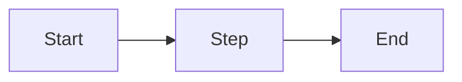

# Module: {TITLE}

**Status:** draft  
**Last verified:** YYYY-MM-DD  
**Source:** browser observation | network capture

## Purpose

One paragraph: what job this area does for the account holder.

## Entry points

- Nav: …
- Deep links: …
- Permissions: …

## Screen inventory

| Screen / tab | URL pattern | Summary |
| --- | --- | --- |
| | | |

## UI components

### Forms

| Field | Required | Validation | Notes |
| --- | --- | --- | --- |
| | | | |

### Tables / lists

| Column | Sortable | Filter | Notes |
| --- | --- | --- | --- |
| | | | |

### Actions

| Action | Type | Confirmation | Side effects |
| --- | --- | --- | --- |
| | | | |

## Workflows

## Inferred data model

| Entity | Key fields | Relations |
| --- | --- | --- |
| | | |

## Network (optional)

| Method | Path pattern | Request shape | Response shape |
| --- | --- | --- | --- |
| | | | |

Redact secrets in committed docs.

## Edge cases

- Empty states
- Error messages (exact copy)
- Loading and pagination

## Open questions

- …