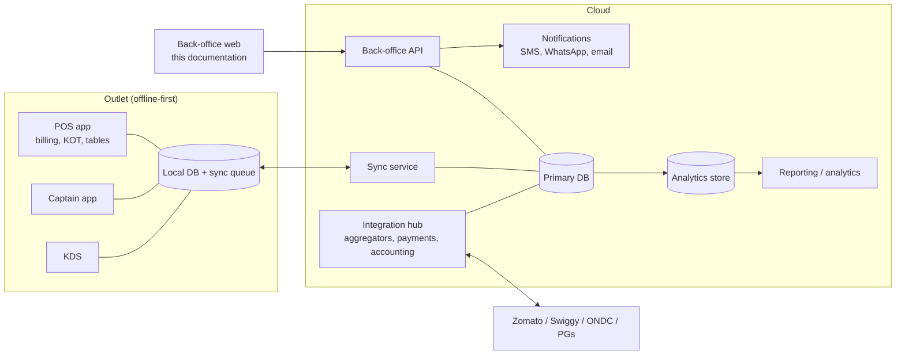
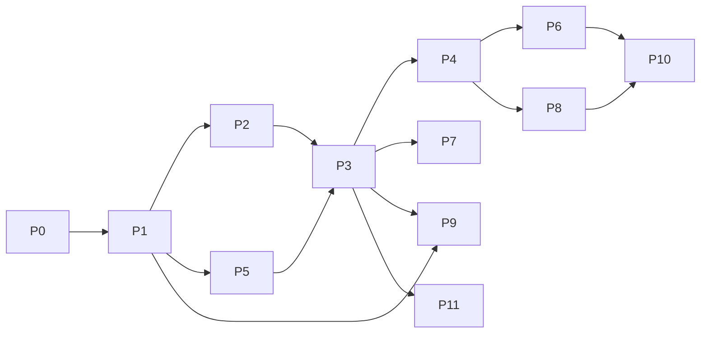

# Implementation roadmap (REA-POS)

**Audience:** tech lead and sub-agents. This is a **recommendation** derived from the Petpooja feature set; it is not a description of Petpooja's internals.

**UI override:** If the goal is a **visual + feature clone** of Petpooja Billing, follow [`../../petpooja-clone/`](../../petpooja-clone/) (especially UI fidelity and clone backlog). This roadmap remains useful for domain engines and data architecture, not for inventing a different admin UI.

## Architecture target

Principles:

1. **Multi-tenant from day 1:** organization → brand → outlet. Every row carries `org_id` and `outlet_id`. Head-office "push to outlets" is a first-class operation.
2. **Offline-first POS:** orders, KOTs and payments are created locally with client-generated IDs (ULID). Sync is idempotent and works in batches (Petpooja exposes batch size and interval settings).
3. **Typed settings document per outlet**, versioned, with JSON Schema, searchable labels, copy-to-outlet, and an audit log of every change.
4. **Append-only audit events.** Every log page is a filtered view of this one table.
5. **Entitlements** gate every add-on feature, and the UI shows upsell cards when a feature is inactive.
6. **Connector framework** for third parties, with request/response logs.
7. **Report registry**, not hand-built pages.

## Phases

| Phase | Scope | Docs | Exit criteria |
| --- | --- | --- | --- |
| **P0 Foundation** | Tenancy, auth (email/phone + password, 2FA, OTP), RBAC, audit events, settings framework, entitlements, file storage, notifications skeleton | [01](../01-authentication.md), [09](../modules/09-users-devices.md), [10](../modules/10-logs-audit.md), [12](../modules/12-marketplace-integrations.md) | Admin logs in and creates an outlet; every change is audited |
| **P1 Menu** | Categories, items, variations, addon groups, menu areas + area pricing, tables/areas, taxes (GST/VAT, forward/backward, tax-on-tax), order preferences, CSV import/export, images | [04](../modules/04-menu-management.md) | Full menu is configured and its tax computation is unit-tested |
| **P2 Outlet config** | All 15 config sections, invoice sequences, sub-order types, delivery distance/area charges, floor plan | [07](../modules/07-outlet-configuration.md) | Settings drive POS behaviour |
| **P3 POS core** | Billing screen, order types, KOT, table management, settlement (split/part payment), round-off/service/container/delivery charges, surcharge, tips, cancel/edit/complimentary/sales return with reasons, negative quantity, NC, OTP approvals, day end/shift, cash movements, denominations, printing | [03](../modules/03-orders-billing.md), [07](../modules/07-outlet-configuration.md), [08 §6, §9](../modules/08-accounting-payments.md) | Offline billing works and syncs |
| **P4 Back-office orders** | Live orders, All Orders (17 filters, export, edit, cancel, OTP remove), KOT list, Day End Summary, dashboard KPIs | [02](../02-dashboard.md), [03](../modules/03-orders-billing.md) | Matches the dashboard widgets |
| **P5 Discounts** | 8 discount types, channel/outlet scoping, coupons, hierarchy discount OTP | [04 §2.7](../modules/04-menu-management.md#27-discounts--itemsdiscount_list-add-itemsdiscount) | Discount engine passes the test matrix |
| **P6 Reports** | Registry plus the first 30 reports, exports, scheduled report notifications | [06](../modules/06-reports.md) | Report numbers reconcile with orders |
| **P7 Online orders** | Connector framework, order inbox/lifecycle, auto-accept, store/item on/off, menu push + trigger logs, rider info, reconciliation | [03 §3](../modules/03-orders-billing.md#3-online-orders--onlinesonline_dashboard), [04 §4](../modules/04-menu-management.md#4-menu-onoff--menusitem_on_off), [10](../modules/10-logs-audit.md) | One aggregator works end to end (sandbox) |
| **P8 Customers & CRM** | Customers (masking/unlock), tags, feedback, campaigns (SMS/WhatsApp), transactional messages, loyalty, virtual wallet, gift card | [11](../modules/11-crm-marketing.md), [08 §2](../modules/08-accounting-payments.md#2-virtual-wallet--usersvirtual_wallet_list) | Campaign sent; wallet ledger is balanced |
| **P9 Inventory** | Raw materials, units, recipes, auto-consumption, purchase/PO/returns/transfer/wastage, stock counts, production, reports, settings | [05](../modules/05-inventory.md) | Stock moves on sale, and COGS is computed |
| **P10 Payments & finance** | Payment provider integrations, payout tracking, bank accounts, finance dashboard, leakage rules | [08](../modules/08-accounting-payments.md), [13](../modules/13-finance.md) | Leakage report is accurate |
| **P11 Ecosystem** | Captain app, KDS, kiosk, QR ordering, own website, digital display, accounting exports (Tally/Zoho) | [14](../modules/14-ecosystem-apps.md) | — |

## Cross-cutting requirements

| Concern | Requirement (from observed behaviour) |
| --- | --- |
| Money | Integer minor units; per-outlet currency (~56 currencies); round-off rules; decimal settings 1–3 |
| Tax | Item-level taxes per area and order type; inclusive/exclusive; tax-on-tax; cess; HSN; e-invoice IRN; block billing when GST is missing |
| Time | Outlet timezone; business day boundary = outlet closing hour (it can pass midnight); 30-minute slot pickers |
| Sensitive actions | Password re-confirmation (sync code), OTP valid for 10 min (remove order, delete day end, reset wallet), manager password at the POS, hierarchy OTP for discounts |
| PII | Mask customer phone numbers by default; unlock with password per session; DND flag |
| Lists | Standard list shell: date-range presets, filters + More Filters, Search / Show All / Reset, paged server grid, Export Current Page / Export All, bulk Active/Inactive/Delete, CSV/Excel import with a template |
| i18n | Labels are configurable per outlet (order-type labels, discount labels, invoice titles) |
| Observability | Every external call is logged with its payload (webhook logs, menu trigger logs) |