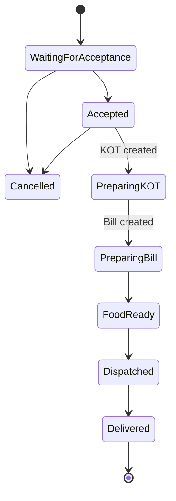

# Module: Orders & Billing (Daily Operations)

**Status:** reviewed
**Last verified:** 2026-11-19
**Source:** server HTML parse of each page + inline AJAX endpoints

Covers: Live Orders, All Orders, Online Orders, KOT, Day End Summary, Delivery Management.

---

## 1. Live Orders — `/orders/running_orders/`

Breadcrumb: Tables › Running Orders

| Element | Detail |
| --- | --- |
| Tabs | Running Orders, Running Tables |
| KPIs | Running order count, running amount (₹), Pending Orders |
| Data | `GET /orders/show_running_orders/{restaurant_id}` (polled) |

Purpose: real-time view of open (unsettled) dine-in tables and orders coming from POS terminals.

---

## 2. All Orders — `/orders/order_list/`

Breadcrumb: Orders And Billing › All Orders

**Tabs:** Order, Advance Order (+ "Last 15 Days Orders" chart)

### Filters (form `data[Order][...]`)

| Label | Field | Type | Options |
| --- | --- | --- | --- |
| Start Date / End Date | `startdate`, `enddate` | datetime | default today 00:00 → tomorrow 00:00 |
| Order Type | `order_type[]` | multi | Delivery, Pick Up, Dine In |
| Order ID | `invoice_id` | text | |
| Customer Name / Phone | `customer_name`, `customer_phone` | text | |
| Sub Order Type | `sub_order_type_id[]` | multi | outlet-defined (e.g. AC, Non AC, Ground Floor, Family) + base types |
| Payment Type | `payment_type` | select | All, Not Paid, Cash, Card, Due Payment, Other, Wallet, UPI, Online |
| Custom payment | `custom_payment_type` | select | outlet-defined (e.g. Gpay, PayTm, Bhim) |
| UPI options / Mobile Wallet / Swipe Card | `upi_custom_payment_type`, `wallet_type`, `swipecard_type` | select | |
| Order Status | `status` | select | All, Saved, Printed, Cancelled, Saved + Printed, Complimentary, Sales Return |
| Other Status | `other_status` | select | All, Discount > 0, Tax > 0, Bill Updated, Bill Reprinted |
| Grand Total | `total1` + `total` | operator (=, >, <) + amount | |
| GSTIN | `gstin` | select | All, With Gstin, Without Gstin |

**Actions:** Search, Show All, More Filters, Export Current Page, Export All, Remove Order.

### Row-level actions / modals

| Action | Detail | Endpoint |
| --- | --- | --- |
| View order detail | Bill + items | `/orders/order_detail/`, `/orders/order_kot_detail` |
| Edit order | Edit items/taxes | `/orders/order_edit/`, `/orders/get_item_taxes/`, `/orders/order_save/` |
| Change payment type | | `/orders/change_payment_type/` |
| Cancel Order | Reason required (`cancel_reason_text`) | `/orders/save_cancel_order/{restaurant_id}` |
| Remove Order | Confirm "Remove Permanently"; OTP verification (valid 10 min) | `/orders/remove_order_billing`, `/orders/delete_order_data_billing/` |
| Generate Invoice (missing online orders) | Platform, Record type (Latest current days / Get old records), From/To date, Order Id(s) | `/orders/get_platform_list/`, `/onlines/missing_invoice_list/` |

List data: `POST /orders/ordlist/` (paged grid).

---

## 3. Online Orders — `/onlines/online_dashboard/`

Breadcrumb: Orders And Billing › Online Orders Activity

### Filters

| Label | Field | Options |
| --- | --- | --- |
| From (channel) | `filter_client` | ~600 aggregator/channel names (Zomato, Swiggy, Magicpin, Dotpe, ONDC, Home Website, Call Center, Menu QR Code, Google Pay, Uber Eats, …) |
| Record Type | `record_type` | Last 24 Hrs, Get old records |
| Start / End Date | `filter_start_date`, `filter_end_date` | |
| Status | `filter_status` | All, Waiting For Acceptance, Accepted, Preparing Food/KOT Created, Preparing/Bill Created, Food Is Ready, Dispatched, Delivered, Cancelled |
| Order No. | `filter_client_order_id` | |

### Grid columns

Order No. · Outlet Name / Order From · Order Type / Rider Details · Customer Details · OTP · Date Time · Total · Status · At · Actions

### Actions & endpoints

| Action | Endpoint |
| --- | --- |
| Load / poll orders | `/onlines/ajax_load_online_orders/`, `/onlines/ajax_new_online_orders/`, `/onlines/ajax_update_online_orders/` |
| Order details | `/onlines/order_details/`, `/onlines/thirdparty_order_details/` |
| Cancel | `/onlines/view_cancel_order/`, `/onlines/ajax_cancel_order/` |
| Generate invoice | `/onlines/generate_invoice/` |
| Swiggy special request | `/onlines/swiggy_special_request_action/` |
| Chart | `/onlines/ajax_online_order_dashboard_chart/` |
| Instructions | `/onlines/instructions_popup/` |
| Webhook logs | `/onlines/get_tp_webhook_logs/` |
| Export | `POST /onlines/download_order_report/` |
| Call customer | Confirm modal "Are you sure want to call the customer?" |
| Packaging hint | "Use Infinity box packaging for this order" |

### Online order lifecycle (observed statuses)

Auto-accept, auto-cancel duration and KOT/bill printing on accept are configured in [Outlet Configuration › Online/Advance Order](./07-outlet-configuration.md#13-onlineadvance-order).

---

## 4. KOT (Kitchen Order Tickets) — `/items/kot_list/`

| Filter | Field | Options |
| --- | --- | --- |
| Start / End Date | `startdate`, `enddate` | |
| Order Type | `order_type[]` | Delivery, Pick Up, Dine In |
| Kot ID | `kot_id` | |
| Customer Name / Phone | | |
| Table No. | `table_no` | |
| Status | `status` | All, Cancelled, Active, Used In Bill, Shifted |
| Filter | `used_in_filter` | All, Modified KOTs |

Actions: Search, Show All, More Filters, Export Current Page, Export All. Data: `/items/klist/`; detail `/items/kot_detail/` and linked `/orders/order_detail/`.

---

## 5. Day End Summary — `/orders/day_end_summary/`

Breadcrumb: Reports › Day End Summary

Filters: Start/End date, Billing User (`biller_user`). Actions: Search, Show All, Export, **Remove** (requires OTP).
Endpoints: `/orders/dayendsummary/`, `/orders/day_end_summary_detail/`, `/orders/send_dayend_otp/`, `/orders/delete_dayend_data/`.

Day-end behaviour is configured in [Connected Services › Day End Settings](./07-outlet-configuration.md#10-connected-services).

---

## 6. Delivery Management — `/orders/delivery_services_list/`

Breadcrumb: Reports › Delivery Management

Widgets: "Last 7 Days Orders", "Last 7 Days – Delivered Orders" charts.
Filters: Start/End date, Provider (`provider_type`): Adloggs Rider, Borzo, Chowman Rider, DoorDash Drive, Dropit, Dunzo B2B, Easymovr, Elemobility, Fynito, GoYo, Grab, Iwingzy, Jugnoo, Lalamove, MFB, NowBike, Opoli Ezip, Parsel, … (~30 providers).
Endpoints: `/orders/deliveryserviceslist/`.

---

## Inferred entities

`Order` (invoice_id, order_type, sub_order_type_id, status, payment_type, custom_payment_type, totals, discount, tax, gstin, customer, biller, table_no, created_at), `OrderItem`, `KOT` (kot_id, status, table_no, used_in_bill), `OnlineOrder` (client, client_order_id, status, rider, otp), `DayEnd` (biller_user, date, totals). See [data-model](../reference/data-model.md).

## Open questions

- Exact column set of All Orders grid (populated by AJAX; empty in demo).
- Advance Order tab fields (shares filter form; rows not observed).