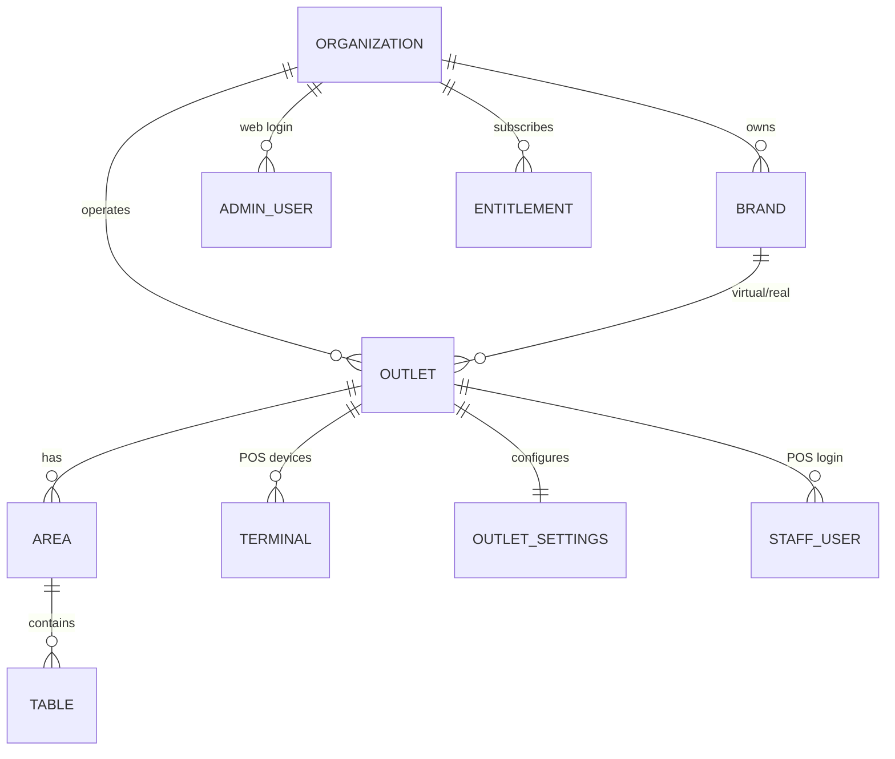
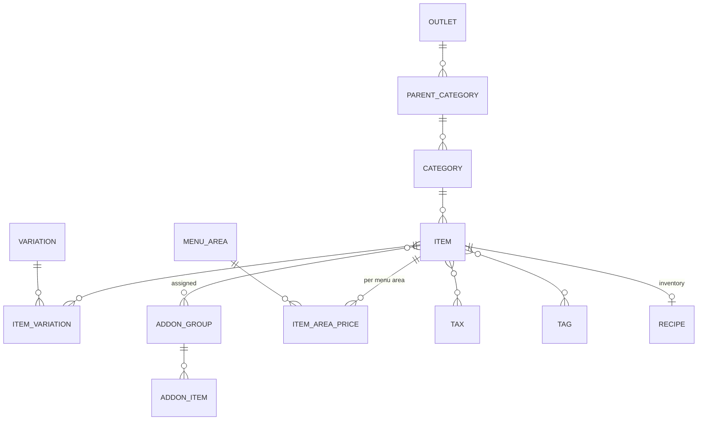
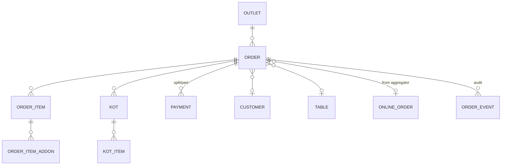

# Inferred data model

**Status:** inferred from UI fields, filters and endpoints — design guidance for REA-POS, not Petpooja's schema.

## Tenancy

- **Organization / HO** (head office) can push menu, taxes, discounts, settings to outlets ("Copy to branch", "Push to Outlets", `/ho/*`).
- **Outlet** = `restaurant_id`. Operation type COCO/COFO/FOCO/FOFO.
- **Virtual brand** = sub-menu + bill header/footer under the same outlet.

## Menu

| Entity | Key attributes |
| --- | --- |
| Category | name, parent, group (veg/non-veg/others), rank, timings (schedule), order-type exposure (dine-in/delivery/pickup), expose online / captain / dine-in QR, image |
| Item | name, short_code, online_display_name, price, description, dietary (veg/non-veg/egg), is_combo, is_favourite, expose_online, expose_kiosk, dinein_qr, ignore_tax, ignore_discount, hsn, sap_code, image(s), available, rank |
| Variation | name, status; item-variation price |
| AddonGroup | name, min/max selection, status, rank; per-area zone price; expose online/POS/captain |
| MenuArea | Base Menu, Home Delivery, Parcel, Dine In (+ custom areas) |
| Tax | kind (GST/VAT/custom), title, rate, type percentage/fixed, mode forward/backward/tax-on-tax, areas, order types, sap codes, status |
| Discount | see [discount form](../modules/04-menu-management.md#27-discounts--itemsdiscount_list-add-itemsdiscount) — type ∈ {percentage, fixed, bogo, dish, flat_rate, bxgy, freebie, fixed_price}, channel, applicability, limits, schedule, coupon mode |
| SpecialNote | type ∈ {item_note, cooking_preference, order_note, allergen} |
| Commission | item/addon, type percentage/fixed, value |

## Orders

| Entity | Key attributes |
| --- | --- |
| Order | invoice_no (per invoice sequence), order_type (dine_in/pickup/delivery), sub_order_type, status (saved/printed/settled/cancelled/complimentary/sales_return), advance flag + delivery datetime, pax, table, biller, captain, waiter, delivery_boy, subtotal (core), discount(s) + reason, service_charge, container_charge, delivery_charge, surcharge, taxes[], round_off, tip, total, customer_paid, change, gstin (B2B), irn (e-invoice), print_count, edited/reprinted flags, source (pos/captain/online/kiosk/qr/website/call_center) |
| OrderItem | item, variation, qty (may be negative), price, nc flag (price changed), discount, tax, special note, kot_id, assignee (commission) |
| KOT | kot_no (daily reset), status (active/used_in_bill/cancelled/shifted), modified flag, punched_by, punched_at, ready_at |
| Payment | mode (cash/card/upi/wallet/due/other/online/part), custom type, provider ref, amount, status |
| OnlineOrder | partner, partner_order_id, status lifecycle, rider (name/phone/otp), prep time, cancel reason, raw payload, webhook logs |
| DayEnd / Shift | biller, opening cash, closing cash, denominations, totals, expenses, withdrawals, top-ups |

## Customers, CRM, payments

| Entity | Key attributes |
| --- | --- |
| Customer | phone (unique per org, masked in UI), name, email, dob, anniversary, address(es), locality, source, dnd, crm_eligible, tags |
| WalletCard / WalletTxn | card_no, customer, balance, status; txn type topup/redeem/refund/return/replace, mode |
| LoyaltyAccount / LoyaltyTxn | points earn/redeem/revert |
| GiftCard | code, value, balance |
| Feedback | order, channel, ratings, comment, type |
| Segment / Campaign / MessageCredit | rules; channel sms/whatsapp; schedule; status; balance |
| DigitalPayment | provider, order, amount, payout status chain, bank account |
| ExpenseHead / ExpenseEntry | type (expense/withdrawal/cash_topup), title, amount, paid_from, biller, date |

## Inventory

RawMaterial, Unit (purchase ↔ consumption conversion), Recipe (+ area recipe), Supplier, InventoryDocument (purchase, PO, purchase_return, sale, transfer, sales_return, wastage) + lines, StockCount (available/closing, frozen), ProductionPlan/Execution, Barcode.

## Platform

AdminUser (2FA), StaffUser (type, passcode, swipe code, group), Permission/UserGroup, Terminal/Device (mapping code, version, last sync), Entitlement, Integration/Connector + credentials + logs, AuditEvent, Notification, ReportSchedule, QuickLink, SupportTicket.